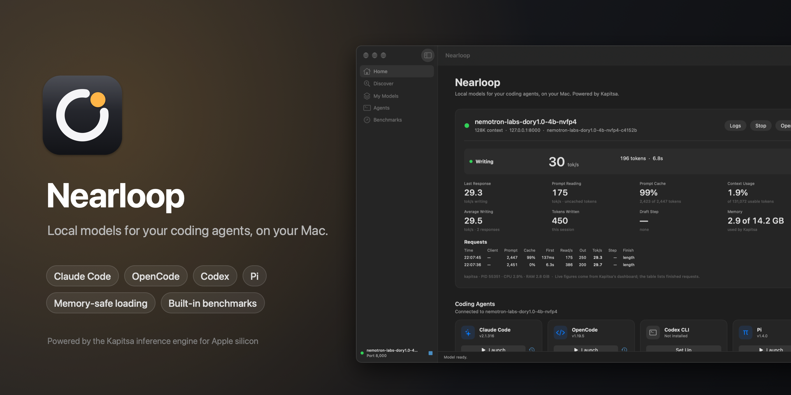
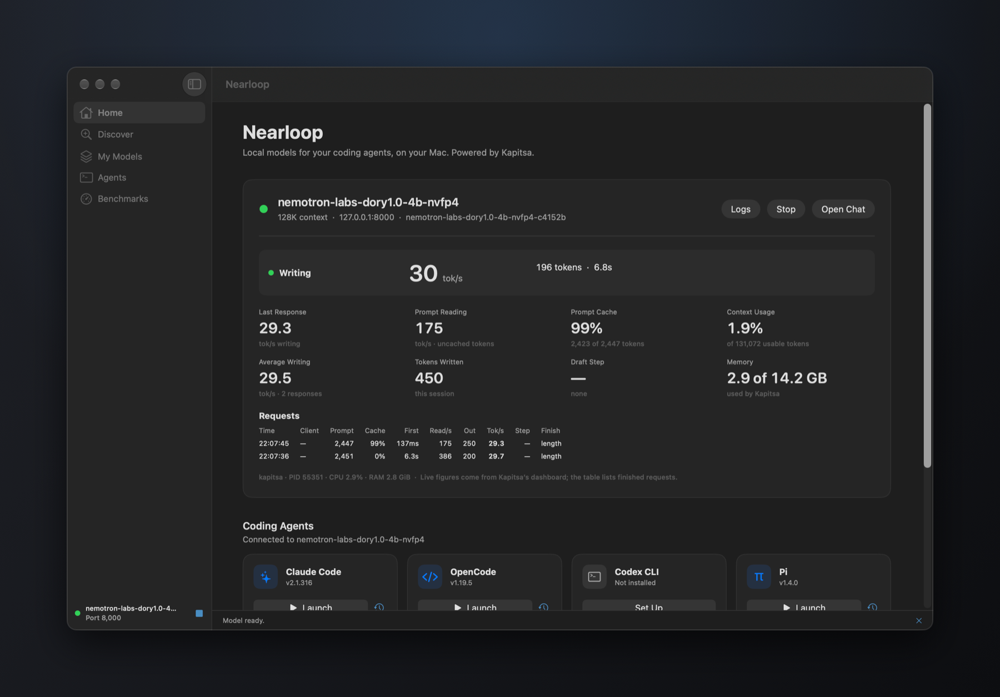
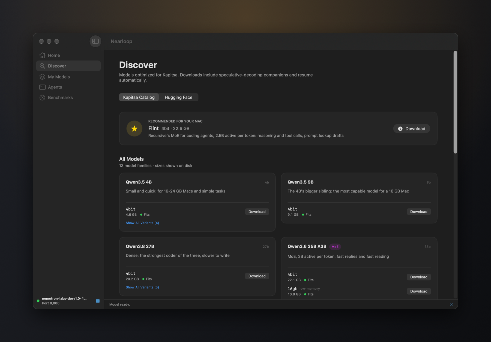
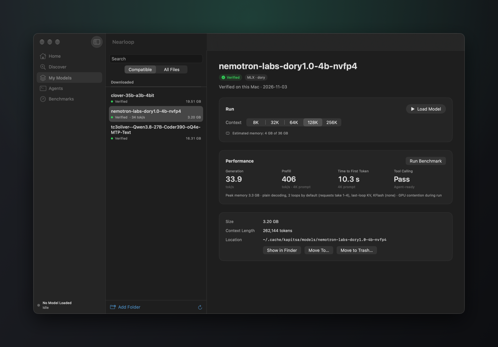
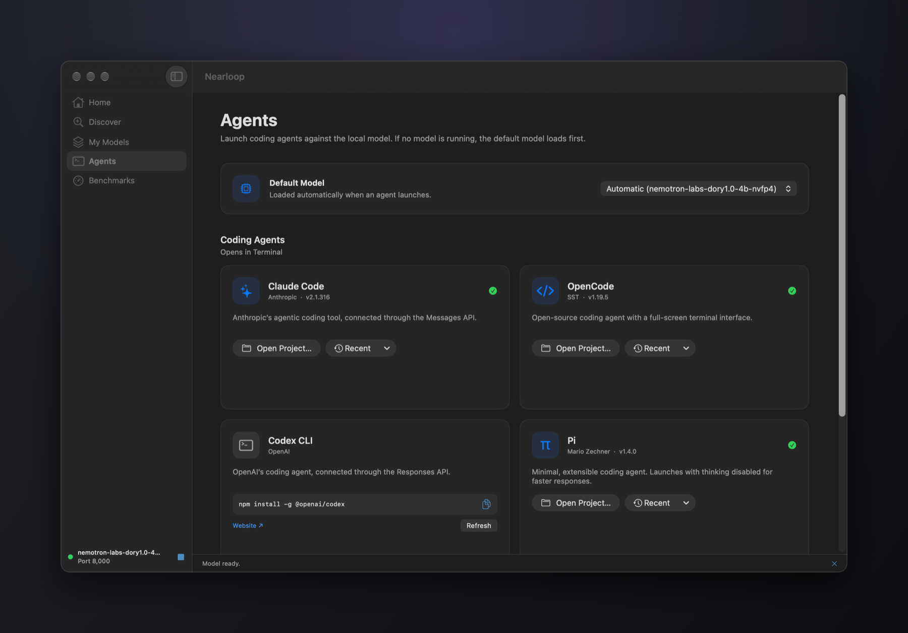
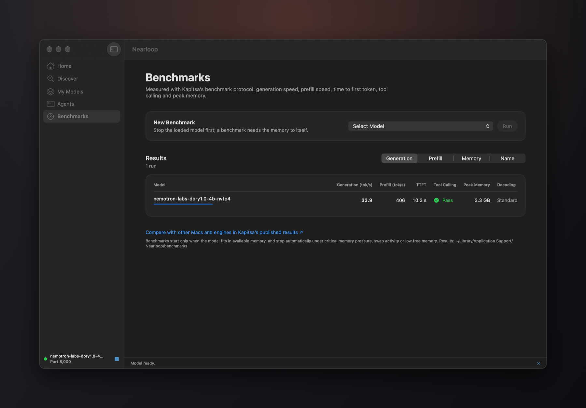
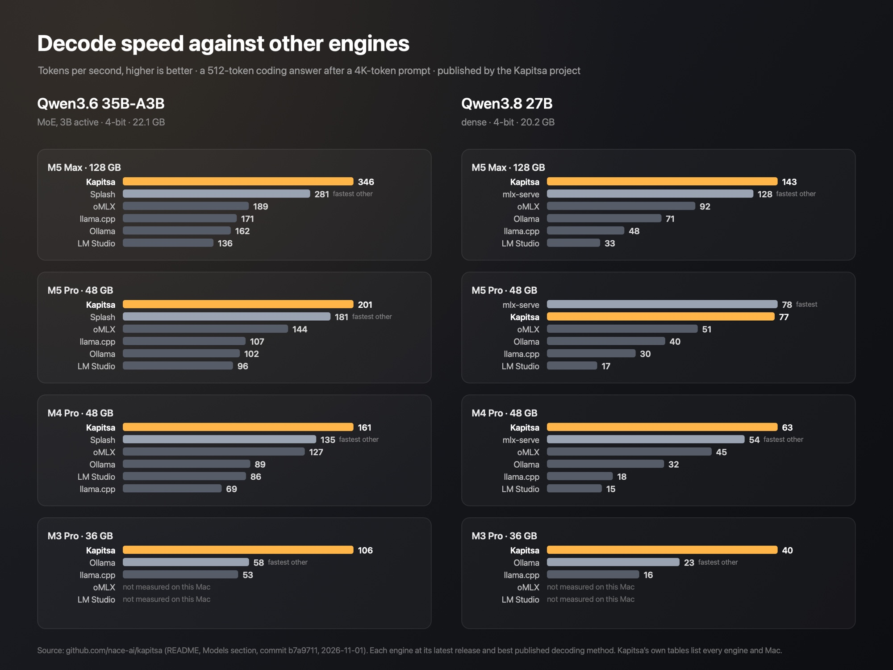

# Nearloop



*Formerly Kapitsa Library.*

[](https://ko-fi.com/aditya2128)

A Mac app for running language models locally and using them with coding agents: Claude Code, OpenCode, Codex CLI and Pi. It is built on **[Kapitsa](https://github.com/nace-ai/kapitsa)**, the open-source inference engine for Apple silicon by the team at [Nace AI](https://nace.ai), which ships inside the app. There is nothing else to install.

> **Built on Kapitsa.** The engine, its KFlash speculative decoding, the model catalog and the benchmark protocol are the Kapitsa project's work: [github.com/nace-ai/kapitsa](https://github.com/nace-ai/kapitsa). This app is an independent desktop front end for it.

- **Discover** models in Kapitsa's catalog (Qwen3.5, 3.6 and 3.8, NVIDIA Nemotron, Dory, Flint, Clover) or search Hugging Face for compatible MLX models. Each one shows whether it fits your Mac. Downloads show progress and resume after a pause.
- **Start an agent** in a project folder with one click. If no model is running, the app loads your agent model first, then opens the agent in Terminal or Ghostty.
- **Never run out of memory.** Kapitsa is capped below the memory that is free when a model loads, so loading never pushes macOS into swap; a model that doesn't fit is refused with a clear message.
- **Measure** writing and reading speed, time to first token, tool-call support and peak memory with Kapitsa's own benchmark. The benchmark stops itself if memory pressure turns critical.
- **Use your existing models.** Add any folders, on any drive; MLX folders and GGUF files are detected from their config and file header. GGUFs can be converted for Kapitsa. Move a model to another folder or drive, or to the Trash, from My Models.
- **Stays out of the way.** A menu bar icon keeps the server one click away after you close the window. Optionally open at login and load your last model automatically.

## Screenshots

| | |
|---|---|
|  |  |
| **Home.** The running model's live writing speed, prompt cache, context and memory, as Kapitsa reports them, plus one-click coding agents. | **Discover.** Kapitsa's catalog and Hugging Face, with a fit check for your Mac. |
|  |  |
| **My Models.** Your folders and downloads, with a memory estimate for each context size and measured speed. | **Agents.** Launch Claude Code, OpenCode, Codex CLI or Pi in any project. |



**Benchmarks.** Kapitsa's own protocol, with memory guards, run from the app.

## Performance

Kapitsa is among the fastest engines on Apple silicon. The Kapitsa project measures it against other engines on several Macs with one protocol: a 4K-token prompt, then a 512-token coding answer. Its published numbers for the two models most people use for coding:



| Qwen3.6 35B-A3B, decode tok/s | Kapitsa | oMLX | LM Studio | Ollama | llama.cpp | Fastest other |
|---|---|---|---|---|---|---|
| M5 Max · 128 GB | **346** | 189 | 136 | 162 | 171 | Splash 281 |
| M5 Pro · 48 GB | **201** | 144 | 96 | 102 | 107 | Splash 181 |
| M4 Pro · 48 GB | **161** | 127 | 86 | 89 | 69 | Splash 135 |
| M3 Pro · 36 GB | **106** | — | — | 58 | 53 | Ollama 58 |

- **Qwen3.6 35B-A3B:** Kapitsa decodes 1.3–1.8× as fast as oMLX, 1.8–2.1× as fast as Ollama and 1.9–2.5× as fast as LM Studio on the Macs measured.
- **Qwen3.8 27B:** 1.4–1.6× oMLX and 4.2–4.5× LM Studio.
- **Not first everywhere:** on an M5 Pro, mlx-serve is a hair ahead on the 27B (78 against 77 tok/s). Across all of its comparisons, Kapitsa reports the fastest decode in 33 of 38 model-and-Mac pairs.
- **On the author's M3 Pro, measured with this app:** Qwen3.8 27B with its DFlash2 drafter wrote at 36.1 tok/s, close to Kapitsa's published 40. A third-party Qwen3.6 35B-A3B pack without a drafter wrote at 41 tok/s, against 106 published for the catalog build, which includes one. That is why the app recommends catalog downloads.

Sources: [Kapitsa README, Models section](https://github.com/nace-ai/kapitsa/blob/b7a971186e876c4249f174de3bc1f6778c5dae8b/README.md#models) at commit `b7a9711`, with each engine's version and settings; methodology in [docs/benchmarks.md](https://github.com/nace-ai/kapitsa/blob/b7a971186e876c4249f174de3bc1f6778c5dae8b/docs/benchmarks.md); every recorded run in the [benchmark table](https://github.com/nace-ai/kapitsa/blob/b7a971186e876c4249f174de3bc1f6778c5dae8b/bench/README.md). `kapitsa bench --submit` adds your Mac to the [community results](https://github.com/nace-ai/kapitsa/blob/main/bench/community/RESULTS.md).

## Requirements

- A Mac with Apple silicon, macOS 14 or later
- Enough memory for the model you choose: the app shows a fit estimate for every model; 16 GB runs small models and 32 GB or more runs the 27B–35B coding models
- For agents: Claude Code, OpenCode, Codex CLI or Pi installed (the Agents page shows each one's install command)

## Using it

1. Open the app. **Home** recommends a model for your Mac; click **Download**, or **Add a Models Folder** if you already have models.
2. Click **Load Model**. The live panel shows writing and reading speed, cache reuse, context used and GPU memory.
3. On **Home** or **Agents**, click **Launch** next to an agent and choose a project folder.

Other apps can use the running model too. The base URL is `http://127.0.0.1:8000/v1`, which is OpenAI-compatible (chat completions and responses) and Anthropic-compatible (messages); any API key works unless you set one in Settings. **Agents ▸ Install Command** adds a `kapitsa` command to `~/.local/bin`, so `kapitsa claude`, `kapitsa opencode`, `kapitsa codex` or `kapitsa pi` start an agent on the running model from any terminal.

### Settings

| Tab | Options |
|---|---|
| General | Open at login; load the last model on launch; Terminal or Ghostty for agents |
| Server | Port; simultaneous requests; SSD prompt-cache size; visibility on the local network (off by default); optional API key |
| Memory | Memory protection (on by default) and how much memory to keep free for other apps |
| Storage | Where Kapitsa keeps downloads, converted models and caches (default `~/.cache/kapitsa`; an external drive works) |

## Privacy

Everything runs on your Mac. The app contacts the network only to download models you choose (from Hugging Face, through Kapitsa) and to search Hugging Face when you use that tab. It has no accounts and no telemetry. The server listens only on this Mac unless you turn on network visibility.

## Building

```sh
./build-library-app.sh            # builds Nearloop.app with Kapitsa bundled (from Homebrew, or KAPITSA_BIN=/path/to/kapitsa)
scripts/package.sh                # makes dist/Nearloop-<version>.dmg
```

The sources are in `App/` (SwiftUI, no dependencies) and the icon in `icon/` (`make-icon.swift` draws it). README images are composed from window captures by `docs/images/compose.swift`; the engine chart is drawn from Kapitsa's published numbers by `docs/images/engines.swift`. To share the app without Gatekeeper warnings, sign and notarize it with a Developer ID Application certificate:

```sh
SIGN_IDENTITY="Developer ID Application: Your Name (TEAMID)" NOTARY_PROFILE=kapitsa-notary scripts/package.sh
```

The header of `scripts/package.sh` explains the one-time notary setup. The bundled Kapitsa never updates itself (that would break the app's signature), so rebuild to update it.

## Support

Nearloop is free. If it's useful to you, you can support its development on [Ko-fi](https://ko-fi.com/aditya2128).

## License

Nearloop is licensed under the [Apache License 2.0](LICENSE). The bundled Kapitsa engine, the coding agents and the models keep their own licenses (see Credits).

## Credits

- **Inference engine:** [Kapitsa](https://github.com/nace-ai/kapitsa) by Nace AI, Apache License 2.0. Its license and third-party notices ship in the app at `Contents/Resources/kapitsa-licenses`. Nearloop is an independent front end and is not affiliated with or endorsed by the Kapitsa project.
- **Benchmark data** in this README is published by the Kapitsa project (sources above).
- **Coding agents** are products of their makers: Claude Code (Anthropic), OpenCode (SST), Codex CLI (OpenAI) and Pi (Mario Zechner).
- **Models** keep their own licenses; check each model's card before use.
